

# Jabar Mohamed Reda

### Small tools. Clean interfaces. Offline by default.

---

##  About Me

Hey,
I'm Jabar — I build small, dependency-free web apps that run entirely in your browser.

Most of my work starts from something I use every day: an adhkar tracker, a Quran reading log, a quiet Arabic notes app, a media player. I keep them simple on purpose — no build step, no server, no account. Just open the page and it works, and your data stays on your device in `localStorage`.

I care about Arabic-first interfaces: correct RTL text, readable Arabic typography, and layouts that don't break when the language changes direction. I also write userscripts and Chrome extensions that fix or improve pages I actually browse.

Beyond the browser, I'm interested in Python CLI tools, privacy, and the idea that software should still work when the network doesn't.

> Build tools people can open, use, and keep — offline.

---

## 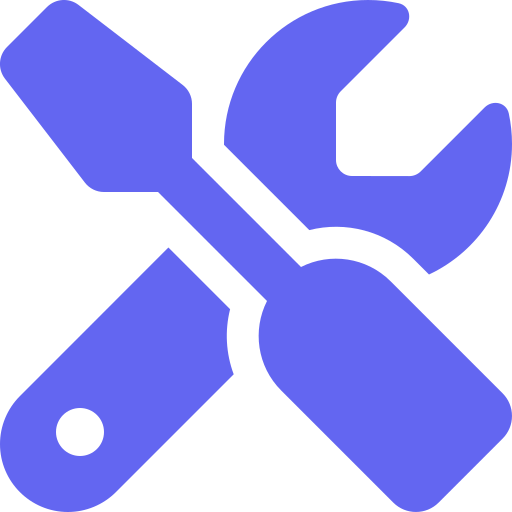 Tech Stack

  

---

## 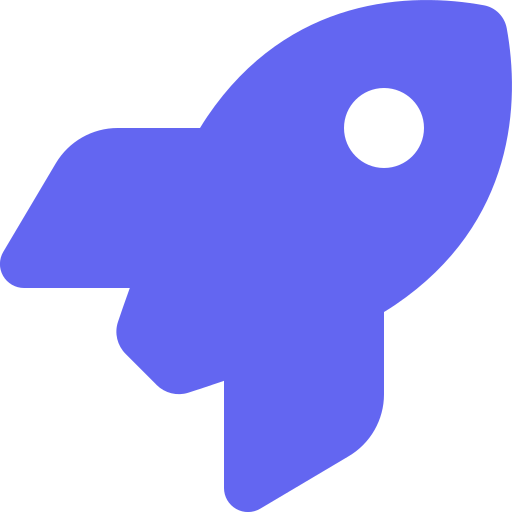 Featured Projects

<table>
  <tr>
    <td width="50%" valign="top">
      <h3>
        <a href="https://github.com/jabar-reda/adkar"> Adhkar</a>
      </h3>
      
<strong>Morning &amp; evening adhkar tracker</strong> — counters, streaks, monthly calendar

      

        
      

      

        A personal tracker for the morning and evening adhkar: one tap per dhikr,
        progress bars per section, a 60-day history, a streak and a monthly calendar.
        No login, no sync, no server — progress lives in <code>localStorage</code>.
      

      

        <code>JavaScript</code>
        <code>localStorage</code>
        <code>Arabic RTL</code>
      

      

        <a href="https://jabar-reda.github.io/adkar/">Live demo →</a>
      

    </td>
    <td width="50%" valign="top">
      <h3>
        <a href="https://github.com/jabar-reda/quran-app">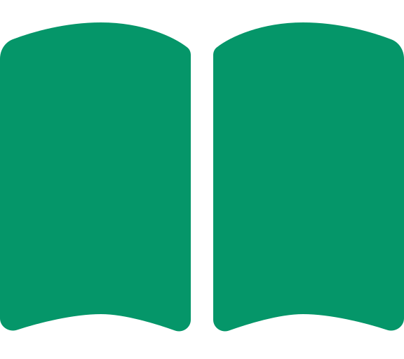 Noor — Khatma Mushaf</a>
      </h3>
      
<strong>Finish the Quran verse by verse</strong> — local-only progress

      

        
      

      

        An in-browser mushaf with all 114 surahs in the Uthmani script. Tap a verse to
        mark it read, follow a daily portion, and export your progress as JSON to move
        it to another browser. Nothing ever leaves the device.
      

      

        <code>JavaScript</code>
        <code>Uthmani script</code>
        <code>Offline</code>
      

      

        <a href="https://jabar-reda.github.io/quran-app/">Live demo →</a>
      

    </td>
  </tr>

  <tr>
    <td width="50%" valign="top">
      <h3>
        <a href="https://github.com/jabar-reda/daftar">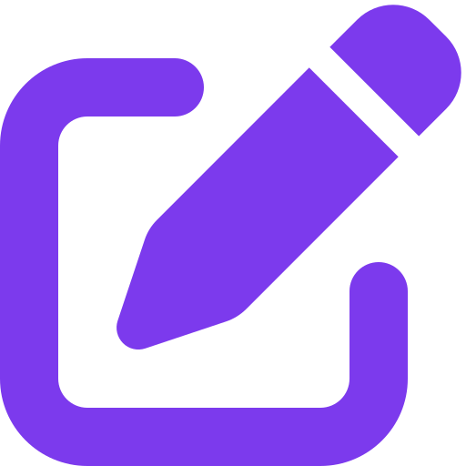 Daftar</a>
      </h3>
      
<strong>A quiet Arabic notes notebook</strong> — offline, no account

      

        
      

      

        A minimal right-to-left notebook that runs fully in the browser. Write a thought,
        close the tab, come back to it. Keyboard-first, saved locally, with no build step
        and no network request.
      

      

        <code>HTML</code>
        <code>CSS</code>
        <code>JavaScript</code>
      

      

        <a href="https://jabar-reda.github.io/daftar/">Live demo →</a>
      

    </td>
    <td width="50%" valign="top">
      <h3>
        <a href="https://github.com/jabar-reda/vlc-web"> VLC Web</a>
      </h3>
      
<strong>A minimalist web media player</strong> — zero dependencies

      

        
      

      

        A black-and-white player inspired by VLC. Opens video, audio, images, text,
        subtitles and playlists straight from your disk — just open <code>index.html</code>,
        no install, no framework, no tracking.
      

      

        <code>JavaScript</code>
        <code>Vanilla</code>
        <code>Media</code>
      

      

        <a href="https://jabar-reda.github.io/vlc-web/">Live demo →</a>
      

    </td>
  </tr>

  <tr>
    <td width="50%" valign="top">
      <h3>
        <a href="https://github.com/jabar-reda/markdown-viewer-extension">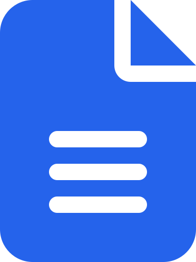 Markdown Viewer</a>
      </h3>
      
<strong>Read local Markdown in Chrome</strong> — fully offline

      

        
      

      

        Chrome shows <code>.md</code> files opened from disk as raw text. This Manifest V3
        extension renders them properly — headings, tables, code, dark and light mode —
        and fixes malformed Windows paths. No server, no network, no dependencies.
      

      

        <code>Chrome Extension</code>
        <code>Manifest V3</code>
        <code>Offline</code>
      

    </td>
    <td width="50%" valign="top">
      <h3>
        <a href="https://github.com/jabar-reda/pinterestui-plus">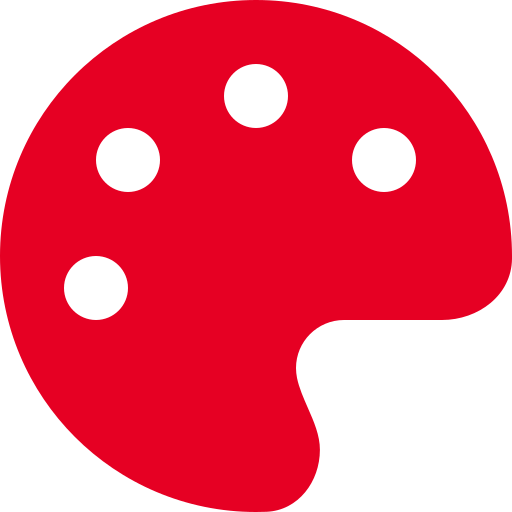 Pinterest UI Plus</a>
      </h3>
      
<strong>iOS-style Pinterest on the web</strong> — dark mode &amp; glass header

      

        
      

      

        A userscript that reshapes Pinterest into a cleaner iOS-like layout: rounded cards,
        a frosted glass header, a floating dock and an iOS-style settings sheet. Installs
        from GreasyFork.
      

      

        <code>JavaScript</code>
        <code>Userscript</code>
        <code>UI/UX</code>
      

      

        <a href="https://greasyfork.org/en/scripts/601440-pinterestui">Install →</a>
      

    </td>
  </tr>
</table>

**More projects**

- 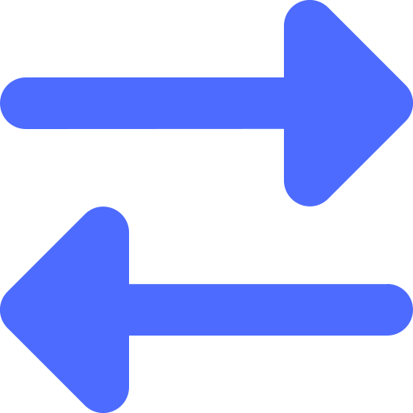 **[DeepSeek RTL Fix](https://github.com/jabar-reda/deepseek-rtl-fix)** — a Tampermonkey script that sets Arabic text in DeepSeek to RTL instantly, without flicker, and keeps code blocks LTR.
- 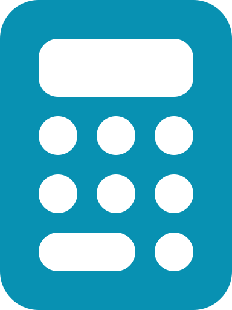 **[B2D](https://github.com/jabar-reda/B2D)** — a minimal binary ↔ decimal converter with arbitrary-precision `BigInt` and live conversion as you type.

---

## 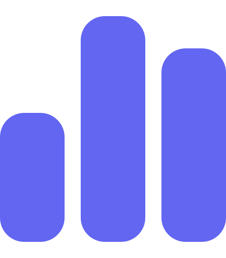 Statistics

  
  

---

## 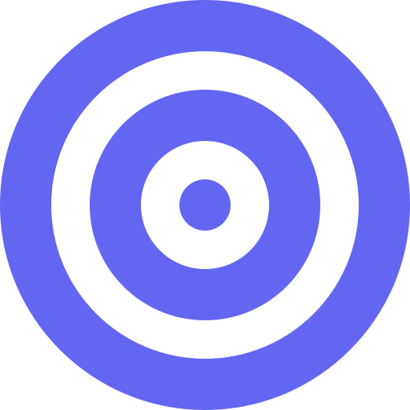 Interests & Focus

* Arabic-first interfaces & correct RTL text
* Local-first, offline web apps
* Userscripts & browser extensions
* Minimal UI/UX and vanilla JavaScript
* Python command-line tools
* Privacy: no accounts, no servers, no tracking

---

##  Find Me

* GitHub → [github.com/jabar-reda](https://github.com/jabar-reda)
* GreasyFork → [greasyfork.org/en/users/1611157-reda-jabar](https://greasyfork.org/en/users/1611157-reda-jabar)
* X → [x.com/JabarReda2012](https://x.com/JabarReda2012)
* Instagram → [instagram.com/jbr.rda](https://instagram.com/jbr.rda)

---

## 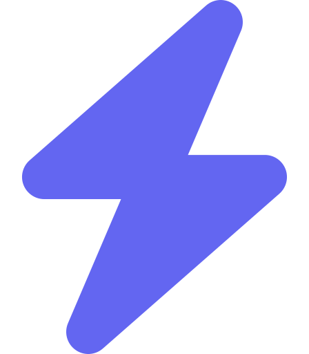 Signature

  
  
  
  

---

Icons by <a href="https://fontawesome.com">Font Awesome Free</a> — <a href="assets/icons/fa/LICENSE.txt">CC BY 4.0</a>.
